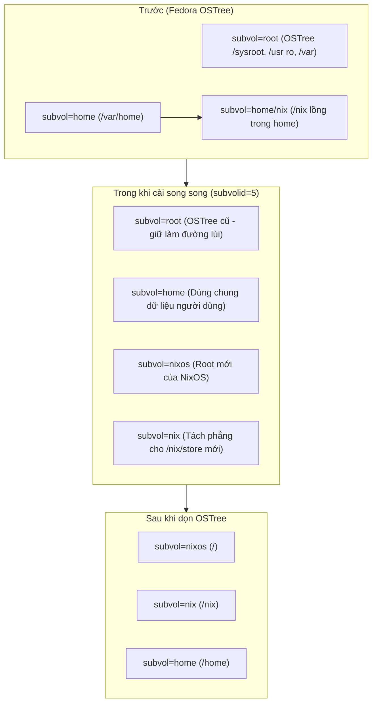

# Dotfiles & Portable NixOS Configuration

Cấu hình NixOS thuần sử dụng Flake cho workstation chạy Hyprland / Sway — **không hardcode hostname, UUID, hay label ổ đĩa trong Git**, giữ tính chất immutable ở cả `/nix/store` và `/etc` (qua `erofs` / `composefs` overlay).

---

## 1. Cấu trúc tách bạch Repo (Chung) vs Máy (Local `/etc`)

- **Trong Git repo (dùng chung cho mọi máy):**
  - **[flake.nix](file:///home/phamnv/dev/dotfiles/flake.nix) & `flake.lock`:** Tự đọc lúc evaluate (`--impure`): hostname từ `/etc/hostname` (hoặc `NIXOS_HOSTNAME`), user từ `$SUDO_USER` / `$USER`, `machine-id` từ `/etc/machine-id`, file hash mật khẩu `/var/lib/nixos/<user>-password-hash`, và cấu hình phần cứng từ `/etc/nixos/hardware-configuration.nix` (fallback sang `/var/mnt/nixos/etc/nixos/...` hoặc `/mnt/etc/nixos/...` khi cài mới).
  - **[nixos/modules/base.nix](file:///home/phamnv/dev/dotfiles/nixos/modules/base.nix):** Base OS & Wayland session lõi (`systemd-boot`, `zramSwap`, immutable `/etc` overlay + `userborn`, NetworkManager + **`nm-openvpn-sso`** tự dò user/session lúc runtime, `nix-ld` + `envfs`, `hyprland`, `sway`, `fcitx5`, `tmpfiles` symlink dotfiles). Bọc sẵn `nh` để `nh os ...` tự truyền `--impure`, và tự bật driver VA-API Intel (`intel-media-driver`, `vpl-gpu-rt`) khi phát hiện `kvm-intel` trong `hardware-configuration.nix`.
  - **[nixos/modules/user-packages.nix](file:///home/phamnv/dev/dotfiles/nixos/modules/user-packages.nix):** Danh sách GUI & CLI Dev Tools (`google-chrome`, `firefox`, `celluloid`, `libreoffice`, `telegram-desktop`, `dbeaver-bin`, `kubectl`, `helm`, `gh`, `nodejs_26`, ...) gắn vào `/etc/profiles/per-user/<user>` — đồng bộ Mesa và rollback cùng generation khi chạy `nh os switch`.
- **Nằm ngoài Git trên từng máy (`/etc` / `/.rw-etc/upper/`):**
  - `/etc/nixos/hardware-configuration.nix` (sinh tự động bằng `nixos-generate-config` theo đúng UUID/label/CPU của máy đó; có thể đặt `time.hardwareClockInLocalTime = true;` nếu dual-boot Windows).
  - `/etc/hostname` & `/etc/machine-id`: định danh riêng của từng máy.
  - `/var/lib/nixos/<user>-password-hash` (tùy chọn; nếu chưa có sẽ dùng `initialPassword = "nixos"`).

### Lệnh sử dụng hằng ngày

```bash
# Áp dụng thay đổi cấu hình OS lẫn User Apps (wrapper nh tự truyền --impure và đọc flake mặc định)
nh os switch

# Cập nhật toàn bộ nixpkgs/inputs trong flake.lock rồi áp dụng đồng bộ
nix flake update && nh os switch

# Kiểm tra những file nào bị thay đổi runtime trong /etc so với cấu hình gốc
ls -la /.rw-etc/upper
```

### Triển khai sang máy mới (không cần sửa repo)

1. Mount các phân vùng của máy mới vào `/mnt` (không bắt buộc đặt label cố định).
2. Sinh cấu hình phần cứng riêng của máy mới vào `/mnt/etc/nixos/hardware-configuration.nix` và đặt hostname vào `/mnt/etc/hostname`:
   ```bash
   sudo nixos-generate-config --root /mnt --show-hardware-config | sudo tee /mnt/etc/nixos/hardware-configuration.nix >/dev/null
   echo "my-laptop" | sudo tee /mnt/etc/hostname >/dev/null
   ```
3. Clone dotfiles vào `~/dev/dotfiles` rồi cài thẳng với `--impure`:
   ```bash
   sudo nixos-install --flake ~/dev/dotfiles#default --impure --root /mnt
   ```
4. Đăng nhập lần đầu bằng mật khẩu tạm `nixos` rồi đổi mật khẩu (`passwd`).

---

## 2. Hướng dẫn Move từ Fedora OSTree (`uBlue` / Silverblue) sang NixOS không cần USB

Áp dụng khi máy hiện tại đang chạy Fedora Atomic / OSTree trên **Btrfs** và **đã cài sẵn Nix** (hoặc cài qua Determinate Nix Installer). Toàn bộ quá trình cài đặt thực hiện trực tiếp từ terminal trên Fedora, giữ nguyên `/home` và giữ nguyên OSTree làm đường lùi cho tới khi NixOS chạy ổn định hoàn toàn.

### 2.1. Sơ đồ Btrfs trước và sau khi chuyển

Trên Btrfs pool (ví dụ `/dev/nvme0n1p3`, gốc `subvolid=5`), ta tạo thêm `subvol=nixos` và `subvol=nix` ngang hàng với `subvol=home` và `subvol=root` (OSTree cũ):



### 2.2. Các bẫy đặc thù trên Fedora OSTree & cách né

1. **Bẫy symlink `/mnt -> var/mnt`:**
   - Trên OSTree, `/mnt` là symlink trỏ về `var/mnt`. Khi mount ổ đĩa vào `/mnt/nixos`, kernel ghi vào `/proc/self/mountinfo` đường dẫn thật `/var/mnt/nixos`, làm `nixos-generate-config --root /mnt/nixos` so lệch chuỗi và **bỏ sót toàn bộ `fileSystems`**.
   - **Cách né:** Luôn mount và truyền đường dẫn thật **`/var/mnt/nixos`** (không có symlink). Không dùng `/run/nixos` để tránh rủi ro tràn RAM `tmpfs` nếu mount nhầm.
2. **Bẫy SELinux `Enforcing` chặn `nixos-enter`:**
   - `nixos-install` chạy `nixos-enter` (chroot) ở bước cài `systemd-boot` và kích hoạt `/etc`. Chính sách SELinux của Fedora sẽ chặn tiến trình trong chroot.
   - **Cách né:** Chạy `sudo setenforce 0` trước khi chạy `nixos-install`.
3. **Bẫy `PATH` và `~/.nix-profile` cũ:**
   - Nếu dotfiles hoặc `environment.d` gán cứng `PATH` với `~/.nix-profile/bin` và `/var/home/...` của Fedora, khi boot sang NixOS sẽ che mất `/run/wrappers/bin` và `/run/current-system/sw/bin`, làm bar/launcher/hotkey không khởi chạy được.
   - **Cách né:** Đưa `/run/wrappers/bin` và `/run/current-system/sw/bin` lên đầu `PATH` (và `/run/current-system/sw/share` lên đầu `XDG_DATA_DIRS`), dùng `$HOME` hoặc `/home/<user>` thay cho `/var/home/<user>`.
4. **Giữ tài khoản, mật khẩu, Keyring và Wi-Fi:**
   - **UID/GID:** Fedora dùng `uid=1000`, `gid=1000`, còn NixOS mặc định gán `gid=100` (`users`). Phải khai báo `users.groups.<user>.gid = 1000` và `uid = 1000`.
   - **Keyring & Mật khẩu:** Giữ nguyên `/etc/machine-id` (xem bằng `cat /etc/machine-id`), bật `services.gnome.gnome-keyring.enable = true`, và trích xuất password hash từ `/etc/shadow` của Fedora sang `/var/lib/nixos/<user>-password-hash` (`chmod 0600`) kết hợp `hashedPasswordFile`.
   - **Wi-Fi / NetworkManager:** Khi dùng `system.etc.overlay`, chép các file `.nmconnection` từ `/etc/NetworkManager/system-connections/` vào `/var/mnt/nixos/.rw-etc/upper/NetworkManager/system-connections/` (`chown root:root`, `chmod 0600`).

---

### 2.3. Quy trình 3 tầng an toàn

#### Tầng 1: Test boot thử trong QEMU VM ngay trên Fedora (không đụng ổ cứng)

Kiểm tra cấu hình NixOS (`kernel`, `systemd initrd`, `/etc` overlay, user/groups) bằng cách mount trực tiếp `/nix/store` hiện tại vào QEMU qua `virtiofs`:

```bash
# Build VM test
nix build ~/dev/dotfiles#nixosConfigurations.default.config.system.build.vm --impure -o result-vm

# Chạy VM (nếu đang trên Fedora cần bọc nixGLIntel cho cửa sổ QEMU)
nixGLIntel ./result-vm/bin/run-*-vm
```

*(Gợi ý: Thêm block `virtualisation.vmVariant` tạm thời với `password = "1234"` và `autologinUser` để test đăng nhập nhanh trong VM).*

#### Tầng 2: Build trước & Cài vào Btrfs subvolume ngay trên Fedora

1. **Tạo subvolume, mount vào đường dẫn thật `/var/mnt/nixos` và sinh `hardware-configuration.nix` của máy:**
   ```bash
   sudo setenforce 0
   sudo mkdir -p /var/mnt/btrfs /var/mnt/nixos

   sudo mount -o subvolid=5 /dev/nvme0n1p3 /var/mnt/btrfs
   sudo btrfs subvolume create /var/mnt/btrfs/nixos
   sudo btrfs subvolume create /var/mnt/btrfs/nix

   sudo mount -o subvol=nixos,compress=zstd:1,noatime /dev/nvme0n1p3 /var/mnt/nixos
   sudo mkdir -p /var/mnt/nixos/{nix,home,boot,etc/nixos}
   sudo mount -o subvol=nix,compress=zstd:1,noatime /dev/nvme0n1p3 /var/mnt/nixos/nix
   sudo mount -o subvol=home,compress=zstd:1,relatime /dev/nvme0n1p3 /var/mnt/nixos/home
   sudo mount /dev/nvme0n1p1 /var/mnt/nixos/boot

   # Sinh cấu hình phần cứng theo đúng UUID/CPU của máy
   sudo nix shell --inputs-from "path:$HOME/dev/dotfiles" nixpkgs#nixos-install-tools \
     -c nixos-generate-config --root /var/mnt/nixos --show-hardware-config \
     | sudo tee /var/mnt/nixos/etc/nixos/hardware-configuration.nix >/dev/null
   ```

2. **Chép password hash (để login và mở khóa `login.keyring`):**
   ```bash
   sudo mkdir -p /var/mnt/nixos/var/lib/nixos
   sudo awk -F: -v u="$USER" '$1 == u { printf "%s", $2 }' /etc/shadow | sudo tee /var/mnt/nixos/var/lib/nixos/${USER}-password-hash >/dev/null
   sudo chmod 0600 /var/mnt/nixos/var/lib/nixos/${USER}-password-hash
   ```

3. **Build sẵn system closure với quyền user thường (trỏ đúng `NIXOS_HARDWARE_CONFIG` và `NIXOS_HOSTNAME`):**
   ```bash
   NIXOS_HOSTNAME="$(cat /etc/hostname)" NIXOS_HARDWARE_CONFIG="/var/mnt/nixos/etc/nixos/hardware-configuration.nix" \
     nix build ~/dev/dotfiles#nixosConfigurations.default.config.system.build.toplevel --impure -o result-system
   ```

4. **Chạy `nixos-install` (copy gói từ `/nix/store` sang `subvol=nix` và cài `systemd-boot` lên ESP):**
   ```bash
   sudo nix shell --inputs-from "path:/home/phamnv/dev/dotfiles" nixpkgs#nixos-install-tools \
     -c nixos-install --root /var/mnt/nixos --system "$(readlink -f result-system)" --no-root-passwd
   ```
   *(Lưu ý không bọc `env PATH="$PATH"` trong `nix shell -c`, vì shell ngoài sẽ mở rộng `$PATH` trước và ghi đè đường dẫn của `nixos-install-tools`).*

5. **Chép sẵn cấu hình Wi-Fi/NetworkManager sang `/.rw-etc/upper`:**
   ```bash
   sudo mkdir -p /var/mnt/nixos/.rw-etc/upper/NetworkManager/system-connections
   sudo chmod 0700 /var/mnt/nixos/.rw-etc/upper/NetworkManager/system-connections
   sudo cp -a /etc/NetworkManager/system-connections/* /var/mnt/nixos/.rw-etc/upper/NetworkManager/system-connections/
   sudo chown root:root /var/mnt/nixos/.rw-etc/upper/NetworkManager/system-connections/*
   sudo chmod 0600 /var/mnt/nixos/.rw-etc/upper/NetworkManager/system-connections/*
   ```

#### Tầng 3: Test boot thật bằng bảo hiểm UEFI `BootNext` & Dọn OSTree sau khi ổn định

1. **Giữ Fedora làm mặc định ở `BootOrder`, chỉ đặt `BootNext` một lần sang NixOS:**
   ```bash
   # Xem mã BootXXXX của Fedora (vd: 0006) và entry mới tạo "Linux Boot Manager" (\EFI\systemd\systemd-bootx64.efi trên PARTUUID của ESP)
   efibootmgr

   # Giữ Fedora đứng đầu BootOrder, đặt BootNext sang NixOS
   sudo efibootmgr -o 0006,<NIXOS_BOOT_NUM>
   sudo efibootmgr -n <NIXOS_BOOT_NUM>
   ```
   -> Chạy `systemctl reboot`. Nếu boot NixOS gặp sự cố, chỉ cần bấm nút Reset/Power là lần kế tiếp UEFI tự quay về Fedora.

2. **Sau khi đã vào NixOS ổn định (chốt mặc định & dọn OSTree cũ):**
   ```bash
   # 1. Chốt NixOS lên đầu BootOrder
   nix shell nixpkgs#efibootmgr -c sudo efibootmgr -o <NIXOS_BOOT_NUM>,0006

   # 2. Gỡ profile Nix cũ của Fedora (chứa nixGL) và dọn symlink icon gãy
   rm -rf ~/.nix-profile ~/.local/state/nix/profiles/profile*
   find ~/.local/share/icons -xtype l -delete

   # 3. Xóa subvolume OSTree cũ (subvol=root và /home/nix cũ) để thu hồi dung lượng
   sudo mkdir -p /mnt/btrfs
   sudo mount -o subvolid=5 /dev/nvme0n1p3 /mnt/btrfs
   sudo btrfs subvolume delete /mnt/btrfs/root
   sudo rm -rf /mnt/btrfs/home/nix
   sudo umount /mnt/btrfs && sudo rmdir /mnt/btrfs
   ```
